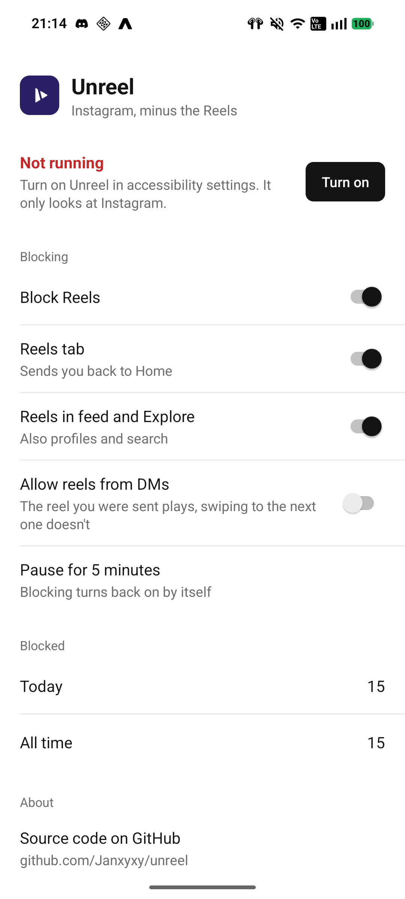
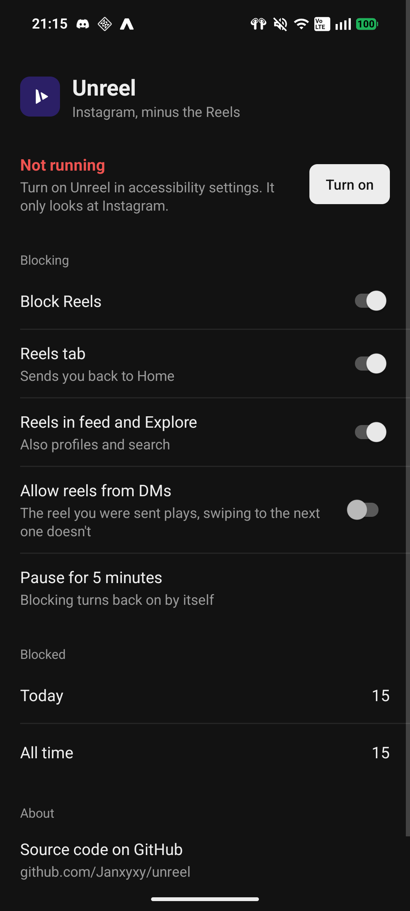

<p align="center">
  
</p>

# Unreel


Unreel is a small Android app that stops you from watching Reels on Instagram. The rest of Instagram works as usual: feed, stories, DMs, profiles.

<p align="center">
  
  
</p>

## How it works

Unreel runs as an accessibility service. That lets it see what Instagram has on screen. When a Reel opens, it presses back for you, so the Reel closes before you get pulled in. If you tap the Reels tab at the bottom, it takes you to the Home tab instead.

It only looks at Instagram. It doesn't read your messages or send anything anywhere, and the only thing it saves is how many Reels it blocked.

## Settings

- **Reels tab** blocks the Reels tab in the bottom bar
- **Reels in feed and Explore** blocks Reels you open from the feed, Explore, profiles or search
- **Allow reels from DMs** lets you watch a Reel a friend sent you, but you can't swipe on to the next one
- **Pause for 5 minutes** turns blocking off for a bit, then it comes back on by itself

## Install

There's no Play Store release. Build it yourself:

```
./gradlew assembleDebug
```

The APK ends up in `app/build/outputs/apk/debug/`. Install it, open Unreel, tap **Turn on** and enable Unreel in the accessibility settings.

On Android 13 and newer, apps installed from an APK can't get accessibility access straight away. Open App info for Unreel, tap ⋮, choose **Allow restricted settings**, then try again.

## If it stops working

Instagram renames parts of its app every now and then, and Unreel finds Reels by those names. They're listed at the bottom of `ReelBlockerService.kt`. To see what Unreel detects while you use Instagram:

```
adb logcat -s Unreel
```

## Screenshots

`scripts/screenshot.sh` builds the app, opens it on a connected phone and saves `docs/screenshot.png`. Run it with `dark` for the dark version. The phone has to be unlocked.
